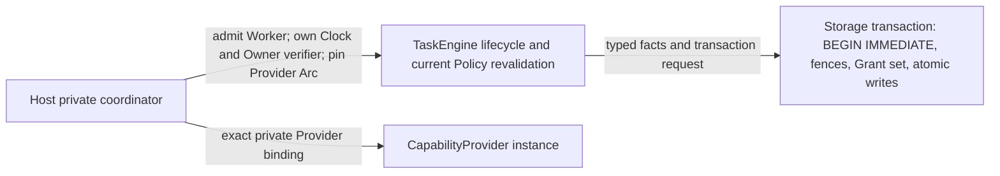

# ADR-0046 Candidate C authority contract

**Decision state: `C_AUTHORITY_CONTRACT_DECISION_READY`; ADR-0046 remains
PROPOSED / NOT RATIFIED.** Source baseline: PR #36 HEAD
`bfe47522d808388f82b55c67793184726273600d`. This document defines a bounded
Host-private coordinator candidate; it does not activate dispatch or create
new production authority APIs.

## Proposed responsibility graph

Host is the only sanctioned entry to a future dispatch decision. TaskEngine
owns task/step lifecycle and re-evaluates current policy against current facts.
Storage owns SQLite serialization, durable lease generation fencing, sealed
Grant membership, and atomic persistence. Host owns the admitted Worker
session, trusted time source, Owner-authentication adapter, and exact Provider
`Arc` selected for the operation. A future private Host coordinator composes
those facts and fails closed if any source, pin, or transaction check is
missing. `pub(crate)` inside Storage, Policy, or TaskEngine is not a boundary
against an external crate consumer.

## Current code and bypass surface

| Claim | Current source/API | What it proves | Remaining bypass or gap |
|---|---|---|---|
| Lease guard | `crates/serea-storage/src/lease.rs`, `LeaseGuard` and `Tx::acquire_lease` | Guard fields are private, non-Clone and tied to Store origin/task/step/owner/generation; storage checks the durable row. | Public `Tx::acquire_lease` accepts caller-created `LeaseOwner`, expected generation and caller-supplied `now` / expiry. Guard origin is not Host Worker admission. External consumer can create a durable lease. |
| Host clock | `crates/serea-host/src/host_clock.rs`; synthetic override is feature-gated | Production Host has a clock abstraction. | Many public Storage/Policy APIs accept `EpochMillis`. Caller time is not trusted Host time; wall-clock rollback, suspend and reboot policy are unsettled. |
| Owner wrapper | `crates/serea-policy/src/approval.rs:328-384` | `AuthenticatedApprovalResponseV1` cannot be directly field-constructed and response fields are revalidated against a request. | Public candidate constructor, verifier trait, and `authenticate(candidate, verifier)` let any downstream caller implement accept-all and mint the wrapper. Current verifier cannot obtain private session provenance from candidate. The wrapper means that some supplied verifier accepted, not that the Owner was authenticated. |
| Grant set | `crates/serea-storage/src/approval.rs`; migration 0005 seal/member constraints | Sealed member cardinality, exact member mapping and one-use constraints are durable DB checks. The test-only `probe_grant_full_set` audits all members and digest fields. | Full-set probe is test-only and read-only, not invoked for authorization. Public `consume_grant_use` can consume a member with caller time; ID-only consumption does not itself bind all request actions, arguments, selected Step and current dispatch facts. A Grant subset digest is distinct from the full Request digest. |
| Policy decision | `crates/serea-policy` evaluation types | Policy evaluates a supplied input and returns an explanation/result. | Caller-composed facts or public decision relabeling are not authority. Current Host must reload/recheck facts and compute its own gate; never accept caller `PolicyEvaluation.decision`, `mismatches().is_empty()`, or a caller-provided Allow as dispatch authority. |
| Provider instance | `crates/serea-capability/src/provider.rs:36-68`; `crates/serea-protocol/src/provider.rs:140-161` | A registry stores `Arc<dyn CapabilityProvider>` and rejects duplicate ProviderId inside that registry. | Another registry may hold a distinct `Arc` with the same ID. Prepared action identity does not pin exact Arc. Provider `health()` defaults to Ready. The public trait lets a holder call its own provider's `invoke`; the Host can constrain only its sanctioned route, not hostile in-process Rust code. |

## Candidate contract at each boundary

### Worker admission and lease

The first safe proof should use one Host-owned Worker/session rather than claim
a general multi-process admission model. Host derives an opaque in-memory
admission record from its trusted process/session configuration; no caller
supplies WorkerId, incarnation, lease owner string, or generation. It samples
the Host clock and asks TaskEngine to bind the selected current Task/Step.
Storage atomically acquires or reclaims the lease and returns the durable
generation-fenced guard. The transaction binds Worker identity/incarnation and
generation if that binding is explicitly designed and ratified. Host restart
invalidates volatile admissions; a new Host incarnation must recover/reclaim
with a new durable generation. External `Tx::acquire_lease` remains a generic
storage operation unless Owner chooses a compatibility-breaking API change;
it must never be accepted as evidence that the Host admitted a Worker.

### Trusted time

Only the Host coordinator may obtain the instant used by an authority decision;
the caller passes no `EpochMillis`. Preferred split for Owner consideration:
monotonic time for freshness/elapsed limits within one boot, wall time for
externally defined expiry, and fail closed after restart/suspend or loss of
monotonic continuity unless a persisted high-water policy is approved. Sample
after the SQLite writer reservation when ordering against durable revocation is
required. Preserve inclusive expiry (`now >= expires_at` expires). Define
rollback and forward-jump thresholds before production use; no thresholds are
ratified here.

### Owner authentication

Host alone constructs the production verifier and converts platform evidence
into an opaque accepted response. The challenge must bind approval ID, request
digest, decision, exact selected Step set/digest, Owner principal, device/session,
confirmation strength, nonce, issue/expiry times and one-time replay state.
The authentication source must prove current principal/session and revocation
status, not accept claims carried in a request. Re-read the challenge and
current ApprovalRequest inside the serialized transaction; persist nonce
consumption and response/Grant atomically. If Host cannot inspect or validate
the required identity/session claim, reject it rather than widening getters by
assumption. The public generic verifier remains an untrusted library seam and
cannot issue production Host authority.

### Grant complete-set verification

Inside one Storage transaction, reload the source Request, Grant, seal, every
ordered member, every member's Task/Step and pinned capability facts, use
records, revocation/state, expiry, and current action/argument digests. Check
the full requested action set separately from the approved Grant subset; require
the selected Step to be exactly one enumerated member and match all pinned
facts. Enforce member count/position/uniqueness and exact digest version. A
missing, extra, reordered, expired, revoked, malformed, or mismatched member
fails closed before any effect. The schema seal is an immutability fence, not a
cryptographic commitment against a database-file attacker. The test-only
`probe_grant_full_set` and successful read-only probes do not establish
authorization.

### Exact Provider instance

Host resolves a private `ProviderBinding` that owns the selected `Arc`,
ProviderId, implementation ID, descriptor digest, registry generation, overlay
revision, Host incarnation and a bounded health observation. The same binding
must be used for precommit validation and immediate preinvoke validation;
compare exact `Arc` identity (`Arc::ptr_eq`) as well as descriptor and revision
pins. Any registry replacement, disable, overlay change, stale health,
shutdown, or generation change invalidates the prepared binding and requires
reprepare/re-authorize. No default Ready value is health evidence. Host-private
routing prevents accidental Host substitution but cannot prevent arbitrary
trusted in-process code that already owns a provider `Arc` from calling that
provider itself.

## Fail-closed ordering and transaction inputs

1. Host accepts only its admitted Worker session and obtains a non-caller time
   sample from its Clock.
2. TaskEngine loads current task/step/plan state and re-evaluates current Policy
   from authoritative facts; caller-composed result labels are discarded.
3. Host pins exact Provider binding and current registry/overlay generations;
   required bounded health check must succeed.
4. Storage starts `BEGIN IMMEDIATE`, then re-reads lease generation, Request,
   Grant full member set, state/revocation/expiry and selected Step bindings.
5. Storage commits one atomic Intent/use/budget/event transition only after all
   preconditions and currently ratified ADR-0045 directions pass. Refusal before
   commit consumes no budget. This is a future design constraint, not a current
   writer.
6. A future one-shot, Host-private by-value authority is consumed immediately
   before invocation; mismatch burns it, no replay is possible. Provider effect
   and its failure/reconciliation behavior require separate Owner decisions.

All time, Worker and Provider inputs to Storage must originate from the private
Host coordinator or a separately approved typed seam. Storage rejects stale
generation, mismatched Task/Step/Request/Grant set, caller time where a trusted
source is required, and any missing/duplicate durable member. Rollback, Host
restart, unknown clock freshness, interrupted effect, DB corruption, and
uncertain Provider readiness all fail closed pending an explicit reconciliation
policy.

## Deterministic negative matrix for a bounded proof

| Area | Required rejection fixture |
|---|---|
| Worker | same owner string from another Worker; prior Host incarnation; stale lease generation; revoked session; no admission; external consumer calling raw `Tx::acquire_lease` |
| Clock | caller-supplied time ignored/rejected; `now == expires_at`; rollback; forward jump; lock wait proves sample ordering; suspend/resume/reboot or missing high-water freshness |
| Owner | accept-all external verifier cannot create Host authority; wrong Owner/device/session; replayed nonce; changed challenge/request digest/selected Steps; expired or revoked challenge; candidate claims inaccessible to trusted Host adapter |
| Grant | full Request digest vs approved subset digest; missing/extra/reordered member; selected Step mismatch; changed arguments/scope; corrupt seal/count/state/use; REVOKED/EXPIRED; one member expires; ID-only public consume path is not accepted as dispatch proof |
| Provider | distinct Arc with same ProviderId; same ID after registry generation change; disabled provider; changed overlay revision/descriptor; default Ready; stale/failed health; exact binding checked both precommit and preinvoke |
| Policy | snapshot reload; Task/Step/Plan mismatch; caller-composed facts; decision relabel; mismatched rule snapshot; Grantless OBSERVE with no approved exception |

No new runtime RED/GREEN or external Cargo experiment was added in this campaign;
the baseline external Cargo probe is recorded in the campaign report. Creating a
Host authority token or production route solely so an external negative test
can reject it would cross the not-ratified boundary. The next bounded test must
exercise private/test-only Host composition after Owner chooses the trust
sources. Rust privacy alone is not treated as process authentication.

## ADR-0045/0046 alignment and limits

Maintain ADR-0045 D1/D2/D3/D5 as direction only: one committed Intent consumes
one tool-call; exact Provider and fresh readiness before commit and immediately
before invocation; one-shot by-value Permit burns on mismatch; and
`CAPABILITY_REQUESTED` denotes committed Intent. D4 remains an interim refusal
to discard unresolved Intent evidence; retention/Forget remains undecided.
ADR-0046 remains PROPOSED / NOT RATIFIED. No architecture version change, P7
Gate D, canonical migration 0009/0010, production Intent writer, Permit
factory, Provider invocation, credential, Memory, Receipt, Retry, external
effect, or production authorization is enabled.
